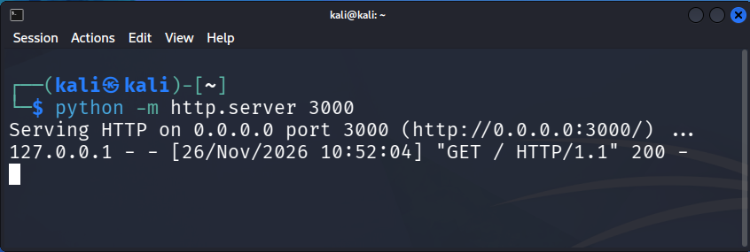

# Web Header Security Auditor

👤 Candidate Name: Mohammad Shah  
🎯 Track: Red Team  
🛠 Tool Name: Web Header Security Auditor CLI  
⏱ Time Spent: ~2 hours
##
## Tool Description
My tool checks whether a website is actually telling browsers how to protect itself. You give it a URL (like a local DVWA lab on localhost), it sends a simple GET request, and then compares the response headers against a checklist of security headers — things like CSP, X-Frame-Options, and HSTS. For every header that’s missing, it tells you how bad the gap is and, more importantly, why it matters in plain English: no CSP means XSS just works, no X-Frame-Options means clickjacking is on the table, no HSTS means someone could strip your HTTPS. At the end it hands you a JSON risk report with a score and grade, so you know exactly what to fix first.

## How to Run

### Step 0 — Requirements
- Python 3.8+ installed
- No external dependencies needed (standard library only), but we'll use a venv for good practice

### Step 1 — Create & activate a virtual environment

**Linux / macOS:**
```bash
cd day2-mohammadshah-redteam-tool
python3 -m venv venv
source venv/bin/activate
```

**Windows (PowerShell):**
```powershell
cd day2-mohammadshah-redteam-tool
python -m venv venv
venv\Scripts\Activate.ps1
```

**Windows (CMD):**
```cmd
cd day2-mohammadshah-redteam-tool
python -m venv venv
venv\Scripts\activate.bat
```

You should see `(venv)` at the start of your prompt.

### Step 2 — Dependencies
```bash
No external dependencies are required.
This tool uses Python standard library modules only.
```

### Step 3 — Start a local target (Terminal 1)
Open a **first terminal**, activate the venv as shown above, then start a
test web server to audit:

```bash
python3 -m http.server 3000
```

Keep this terminal running. It serves a basic server on
`http://localhost:3000` (this server sends NO security headers, which is
perfect for demonstrating the tool). You can also point the tool at your own
DVWA or any other local lab instead.

### Step 4 — Run the auditor (Terminal 2)
Open a **second terminal**, activate the venv again, then run:

```bash
# Scan all URLs listed in sample_input/urls.txt (one URL per line):
python web_header_auditor.py --input sample_input/urls.txt

# Or scan a single URL directly:
python web_header_auditor.py --url http://localhost:3000
```

### Step 5 — View the results
- The terminal prints a graded risk report (e.g. `Grade: CRITICAL`)
- A full JSON report is saved automatically to `sample_output/`
- Sample input lives in `sample_input/urls.txt`

### Expected Output
```
[*] Auditing http://localhost:3000 ...

===== SECURITY HEADER REPORT: http://localhost:3000 =====
Risk Score: 31/31   Grade: CRITICAL

[-] Content-Security-Policy: MISSING (Severity: HIGH)
[-] X-Frame-Options: MISSING (Severity: MEDIUM)
[-] Strict-Transport-Security: MISSING (Severity: HIGH)
...
[*] JSON report saved to: sample_output/report_http__localhost_3000.json
```

> ⚠️ **Non-destructive:** The tool only sends GET requests and refuses to scan
> any target that isn't localhost / 127.0.0.1.


## Output Evidence

**Terminal screenshot:**



**Generated JSON report:** [`sample_output/report_http__localhost_3000.json`](sample_output/report_http__localhost_3000.json)


## Self-Attestation
"I self-sourced all materials, used only public/synthetic/self-owned resources, built a working tool, and performed non-destructive work."


